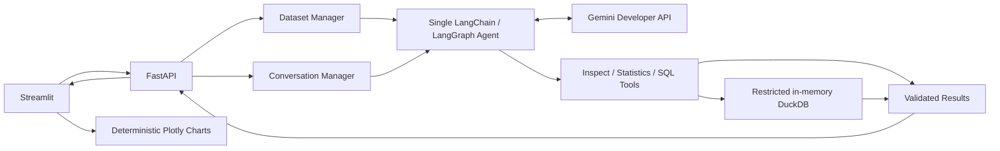

# Agentic AI Data Analyst

A local CSV analysis application built with Streamlit, FastAPI and a single
LangChain/LangGraph agent. The agent can inspect a selected dataset, request
statistics and generate restricted DuckDB SQL; Plotly charts visualize returned
values using deterministic rules.

**Status: local-development-only.** Phases 1–8 are implemented. The Gemini
integration is implemented, but successful real-model analysis is unverified:
the latest approved plain-text request returned **Google HTTP 503 UNAVAILABLE**.
All further Gemini generation and metadata requests are on hold. Docker
configuration exists; image builds and container execution remain unverified.

## Capabilities and stack

- Validate UTF-8 CSVs, inspect inferred types, missing values and statistics.
- Keep independent dataset snapshots and bounded dataset-specific conversation
  context; refresh tool evidence for follow-ups.
- Execute a narrow SQL subset with validation, row/byte caps and an interrupt
  timer; show SQL and result tables alongside explanations.
- Recommend bar/line charts from actual result shapes without model-written code.
- Test the API, agent, SQL boundaries and Streamlit UI without provider access.

Python 3.11 · Pandas/NumPy · FastAPI/Pydantic · LangChain/LangGraph ·
langchain-google-genai (Gemini 3.8 Flash) · DuckDB/SQLGlot · Streamlit/Plotly ·
HTTPX · Pytest · GitHub Actions. Runtime requirements are pinned by service.

## Architecture and agent workflow



A request selects one dataset snapshot. The agent inspects its schema, chooses
statistics or a validated SELECT, then explains tool evidence. Only one tool
per turn is permitted; at most one SQL correction is allowed. Five compact
successful turns can resolve references, but cannot replace fresh evidence.
Gemini chooses tool calls and produces prose; it does not execute Python or
chart code. Charts are built locally. Live behavior remains to be verified.
See [module responsibilities and interview explanation](docs/architecture.md).

## Local Python setup

From PowerShell, use the existing D: environment or create it if absent:

```powershell
Set-Location 'D:\GPT work\CODEX\agentic-ai-data-analyst'
New-Item -ItemType Directory -Path .tmp -Force | Out-Null
$env:TEMP = Join-Path $PWD '.tmp'
$env:TMP = $env:TEMP
if (!(Test-Path '.venv\Scripts\python.exe')) { python -m venv .venv }
.\.venv\Scripts\python.exe -m pip install --no-cache-dir -r requirements.txt
```

Python reads process environment variables; it does not automatically load
`.env`. [.env.example](.env.example) lists settings without a real key.
No key is required for health, upload, inspection, tests or mocked evaluation.

In one terminal, start FastAPI with no provider credentials:

```powershell
Remove-Item Env:GOOGLE_API_KEY -ErrorAction SilentlyContinue
Remove-Item Env:GEMINI_API_KEY -ErrorAction SilentlyContinue
$env:GOOGLE_FREE_TIER_CONFIRMED = 'false'
.\.venv\Scripts\python.exe -m uvicorn backend.main:app --host 127.0.0.1 --port 8000 --workers 1
```

In a second terminal at the same repository, start Streamlit:

```powershell
$env:TEMP = Join-Path $PWD '.tmp'
$env:TMP = $env:TEMP
$env:BACKEND_URL = 'http://127.0.0.1:8000'
.\.venv\Scripts\python.exe -m streamlit run frontend/app.py --server.address 127.0.0.1 --server.port 8501 --browser.gatherUsageStats false
```

Open [the dashboard](http://127.0.0.1:8501) or
[API docs](http://127.0.0.1:8000/docs). Choose **Try the retail sample** to inspect
12 rows and 6 columns without a model call. Stop each server with Ctrl+C.
Natural-language analysis requires a key, Free-project confirmation and separate
approval; do not configure or submit live analysis during the current hold.
`scripts/setup_gemini.ps1` provides masked, Windows-user encrypted local key
storage; `scripts/start_local.ps1` loads it only for the backend. Those scripts
are references for a future approved run, not part of the key-free demo.

## API and limits

| Endpoint | Purpose |
| --- | --- |
| `GET /health` | Process health; does not check Gemini |
| `POST /upload` | Multipart field `file` containing one CSV; returns dataset UUID |
| `GET /dataset/{dataset_id}` | Metadata, preview, missing counts and statistics |
| `POST /analyze` | Question plus dataset UUID and optional conversation UUID |
| `DELETE /conversation/{conversation_id}?dataset_id=UUID` | Reset context |

Defaults: 5 MiB CSV; upload body allowance includes 64 KiB multipart overhead;
32 KiB analysis body; question at most 2,000 characters; 20 datasets; 100
conversations; 30-minute inactivity TTL with lazy cleanup. Backend memory is
single-process and disappears on restart. Clearing the dashboard does not
delete the backend dataset immediately; it expires lazily.

SQL: one SELECT from `dataset`, 8,000-character/256-node maximum, explicit
function/AST allowlists, default 200 returned rows, 128 KiB result-value cap,
5-second interrupt, 128 MB DuckDB memory setting and one engine thread.
External access, automatic/unsigned extensions and temporary spill are disabled.
Default agent limits: 8 model calls, 6 tools, 30 seconds per provider request,
1,200 output tokens and zero retries. A run can outlast the frontend's default
300-second timeout; client disconnects do not cancel backend work.

Errors use sanitized `detail` messages. Oversized bodies return 413; invalid
fields 422; unknown datasets 404; conversation mismatch/busy 409; expired
conversations 410. Backend 502 is a translation and does not identify the
upstream HTTP status. Internal diagnostics retain only allowlisted categories,
numeric upstream status and symbolic status.

## Testing and evidence

```powershell
.\.venv\Scripts\python.exe -m pytest -q --basetemp=.tmp/pytest
.\.venv\Scripts\python.exe -m evaluations.benchmark --output .tmp/benchmark.json
.\.venv\Scripts\python.exe -m pip check
.\.venv\Scripts\python.exe -c "from backend.main import app; import streamlit; print(app.version)"
```

**383 automated tests passed; 28/28 benchmark cases passed using scripted
model actions, not Gemini.**
SQL correctness: 18/18; follow-up context: 3/3; SQL rejection: 4/4; two isolation
cases and one unsupported-question case complete the benchmark. Expected values
come from independent Pandas calculations. This is regression evidence, not
real-model accuracy. Pytest includes Streamlit widget/Plotly tests and sealed
SDK mock transports. See [evaluation methodology](evaluations/README.md) and
[Phase 8 verification](docs/phase8-verification.md) for the actual test count.
GitHub CI runs dependencies/imports, the full suite and mocked evaluation.

## Docker reference — runtime unverified

[Local Docker guide](docker/README.md) documents two non-root Python images,
one backend worker, loopback-only host ports, read-only roots, bounded tmpfs,
dropped capabilities and CPU/memory/PID limits. Static review is not an image
build or runtime test. Docker/WSL installation and public deployment are not
authorized. Leave builds/smoke tests for a separately approved environment.

## Security and known limitations

This application is for a trusted local user with synthetic data. UUIDs select
sessions; they provide no authentication or ownership authorization. There is
no global rate limiting, multi-user isolation or end-to-end request deadline.
Pandas allocations and concurrent requests can exceed per-query DuckDB limits.
Embedded SQL shares backend privileges and credentials; SQL validation and a
container are not complete isolation from malicious SQL. Prompt instructions
cannot guarantee model obedience or factual explanations. Untrusted chat text
is displayed without Markdown parsing.

Real analysis sends questions, recent context and relevant dataset-derived
schema/statistics/results to Google; Free-tier data may be used for product
improvement. Billing remains human-confirmed disabled; the app does not audit
billing. No provider/model fallback exists. Gemini 3.7 Flash is only an unverified,
conditional research candidate, not an approved replacement.
See [security readiness](docs/security-readiness.md),
[historical live evidence](evaluations/phase7-live-status.md) and
[prioritized acceptance checks](docs/acceptance-checks.md).

## Demo and portfolio

[Demo guide and resume suggestions](docs/demo-portfolio.md) use genuine local
upload/inspection and clearly labeled mocked chart tests. No successful Gemini
answer, live chart, public hosting, production readiness or real-model accuracy
is claimed. Phase 8 ends with offline security/documentation work; live testing
and deployment require separate approval.
